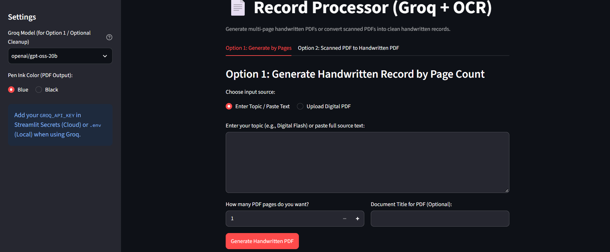
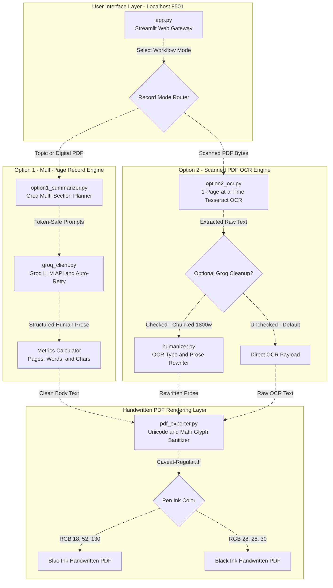

# Record Processor


A local web application (`http://localhost:8501`) for generating multi-page handwritten-style PDF records and converting scanned PDFs into clean, readable documents using Tesseract OCR, Groq AI, and FPDF2.

## About

Record Processor provides a lightweight, local-first pipeline for turning topics, raw notes, and scanned PDFs into authentic handwritten-style records without bloating prompts or exhausting system memory.

Built and maintained by [@SRINIVASTA](https://github.com), this repository hosts a Streamlit web gateway, a multi-section Groq LLM planner, a memory-safe 1-page-at-a-time Tesseract OCR engine, and a TrueType handwriting PDF renderer.




## Modules in this repo

| Module | Description |
| :--- | :--- |
| `option1_summarizer.py` | Multi-page record generator with token-safe prompts and auto-retry logic. Turns topics, notes, or digital PDFs into structured human prose across 1 to 50 pages. |
| `option2_ocr.py` | Memory-safe Tesseract OCR engine that processes scanned PDFs one page at a time to keep RAM usage minimal. |
| `humanizer.py` | Chunked OCR text cleaner (1,800 words per chunk) powered by Groq AI to fix scanning typos and rewrite rough extractions into smooth prose. |
| `pdf_exporter.py` | Handwritten PDF builder using `Caveat-Regular.ttf`. Sanitizes Unicode dashes/spaces, converts math symbols (`∫`, `∂`, `π`, `∞`, `λ`, `∑`), and supports Blue or Black pen ink. |

### Architecture & Workflow



### Key Capabilities

* **Exact Page Targeting & Live Metrics:** Generate 1 to 50 pages of clean body text without unwanted metadata headers, complete with live PDF page count, word count, and character metrics.
* **Zero-API Default OCR:** Convert scanned PDFs directly to handwritten PDFs locally at maximum speed, or toggle optional Groq AI cleanup for typo correction.
* **Authentic Pen Rendering:** Switch between Blue Pen Ink (`RGB 18, 52, 130`) and Black Pen Ink (`RGB 28, 28, 30`) directly from the sidebar.

## Repository Structure

```text
record-processor/
├── .streamlit/
│   └── config.toml             # Theme settings and 50 MB upload limit
├── fonts/
│   └── Caveat-Regular.ttf      # TrueType handwriting font for PDF rendering
├── src/
│   ├── __init__.py
│   ├── groq_client.py          # Groq API client (reads from local .env file)
│   ├── option1_summarizer.py   # Multi-page generator with auto-retry logic
│   ├── option2_ocr.py          # Memory-safe 1-page-at-a-time Tesseract OCR
│   ├── humanizer.py            # Chunked OCR text cleaner for large PDFs
│   └── pdf_exporter.py         # Blue/Black ink handwritten PDF builder
├── .env                        # Local environment file storing GROQ_API_KEY
├── .gitignore
├── app.py                      # Main local web interface
├── requirements.txt            # Python dependencies
└── README.md
```

## Installation & Local Setup

You can clone and run Record Processor locally across Windows, macOS, and Linux:

### 1. Clone the repository

```bash
git clone https://github.com/record-processor.git
cd record-processor
```

### 2. Install system OCR dependencies

#### Windows
1. Download and install **Tesseract OCR** (UB Mannheim build) and **Poppler for Windows**.
2. Add both installation `bin` folders to your Windows **System PATH**.

#### Ubuntu / Debian
```bash
sudo apt-get update && sudo apt-get install -y tesseract-ocr poppler-utils
```

#### macOS
```bash
brew install tesseract poppler
```

### 3. Set up Python environment

```bash
# Create virtual environment
python -m venv venv

# Activate on Windows
venv\Scripts\activate

# Activate on macOS / Linux
source venv/bin/activate

# Install dependencies
pip install -r requirements.txt
```

### 4. Configure environment variables

Create a `.env` file in the root directory (`record-processor/.env`) and add your Groq API key:

```env
GROQ_API_KEY=gsk_your_actual_groq_api_key_here
```

### 5. Launch the application

```bash
streamlit run app.py
```

Open your browser and navigate to `http://localhost:8501`.

## License

This repository is licensed under the MIT License — Copyright (c) 2026 [SRINIVASTA](https://github.com).

## Disclaimer

This project is intended for personal productivity, note-taking, and educational formatting. Users are responsible for ensuring compliance with their institution's academic integrity policies and verifying AI-generated or OCR-extracted content for accuracy.
