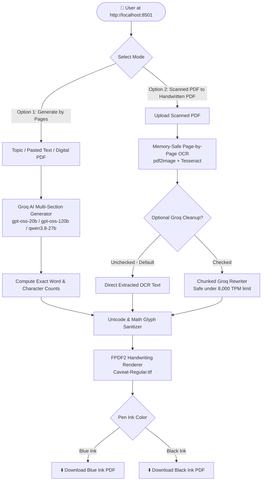

# 📄 Record Processor (Handwritten PDF & OCR Suite)

A local web application (`http://localhost:8501`) for generating multi-page **handwritten-style PDF records** and converting **scanned PDFs** into clean, readable documents using **Tesseract OCR**, **Groq AI**, and **FPDF2**.

---

## 🏗️ System Architecture & Workflow



---

## ✨ Key Features

* **Option 1 — Multi-Page Record Generator:**
  * Enter a topic (e.g., *Digital Flash*), paste source notes, or upload a standard digital PDF.
  * Specify the exact target page count (**1 to 50 pages**) and generate structured, human-style prose without unwanted metadata headers.
  * Displays live **PDF Page Count**, **Word Count**, **Characters (with spaces)**, and **Characters (no spaces)**.
* **Option 2 — Scanned PDF to Handwritten PDF:**
  * Converts scanned PDFs one page at a time locally to keep memory usage minimal.
  * **Direct-to-PDF by default** (fast, zero API limits) with an optional **Groq AI cleanup** toggle to fix scanning typos in safe token chunks.
* **Authentic Handwriting Export (`Caveat-Regular.ttf`):**
  * Switch between **Blue Pen Ink** and **Black Pen Ink** in the sidebar.
  * Automatically converts mathematical symbols (`∫`, `∂`, `π`, `∞`, `λ`, `∑`) and special Unicode dashes/spaces into clean handwritten notation.

---

## 📂 Repository Structure

```text
record-processor/
├── .streamlit/
│   └── config.toml             # Theme settings and 50 MB upload limit
├── fonts/
│   └── Caveat-Regular.ttf      # TrueType handwriting font for PDF rendering
├── src/
│   ├── __init__.py
│   ├── groq_client.py          # Groq API client (reads from local .env file)
│   ├── option1_summarizer.py   # Multi-page generator with auto-retry logic
│   ├── option2_ocr.py          # Memory-safe 1-page-at-a-time Tesseract OCR
│   ├── humanizer.py            # Chunked OCR text cleaner for large PDFs
│   └── pdf_exporter.py         # Blue/Black ink handwritten PDF builder
├── .env                        # Local environment file storing GROQ_API_KEY
├── .gitignore
├── app.py                      # Main local web interface
├── requirements.txt            # Python dependencies
└── README.md
```

---

## 🚀 Running on Localhost

### 1. Clone the Repository
```bash
git clone https://github.com
cd record-processor
```

### 2. Install System OCR Dependencies
* **Windows:**
  1. Download and install **Tesseract OCR** (UB Mannheim build) and **Poppler for Windows**.
  2. Add both installation `bin` folders to your Windows **System PATH**.
* **Ubuntu / Debian:**
  ```bash
  sudo apt-get update && sudo apt-get install -y tesseract-ocr poppler-utils
  ```
* **macOS:**
  ```bash
  brew install tesseract poppler
  ```

### 3. Create a Virtual Environment & Install Python Packages
```bash
python -m venv venv
# Activate on Windows:
venv\Scripts\activate
# Activate on macOS/Linux:
source venv/bin/activate

pip install -r requirements.txt
```

### 4. Add Your Groq API Key
Create a `.env` file in the root folder (`record-processor/.env`) and add your key:
```env
GROQ_API_KEY=gsk_your_actual_groq_api_key_here
```

### 5. Launch on Localhost
```bash
streamlit run app.py
```
Once started, open your browser and go to:
👉 **`http://localhost:8501`**
